# 1. Introduction

*hook: two people, different tastes (utilities), fixed resources. what happens? The five questions this project answers (matching the five sections)*

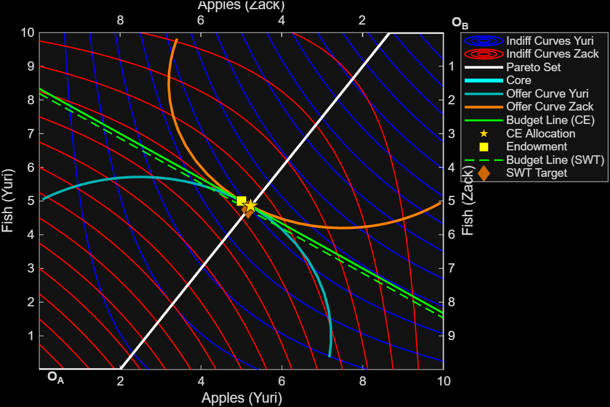{#fig-preview width="100%"}

# 2. The Economic Setup

## 2.1 Agents, Goods, and Preferences

*Define $u_1(x_1, x_2)$, $u_2(x_1, x_2)$ in prose: what utility means, why it's ordinal. Dive into primitive notions of utility, preferences, and assumptions underlying these notions.*

*Brief note on the types of preferences the model handles (normal, Leontief, convex, non-quasi-concave).*

The general form, and the running example used throughout:

$$u_\text{Yuri}(x_1, x_2) = x_1(x_2 + 3), \quad u_\text{Zack}(x_1, x_2) = x_1(x_2 + 2)$$

where $x_1$ = Apples and $x_2$ = Fish, and each function takes the agent's own holdings as arguments.

## 2.2 Endowments and the Edgeworth Box

*What an endowment is; total endowment $\omega = \omega_1 + \omega_2$.*

*The Edgeworth box: explain the geometry in plain language.*

Both agents begin with equal endowments: $\omega_\text{Yuri} = \omega_\text{Zack} = (5, 5)$, giving a total endowment of $\omega = (10, 10)$.

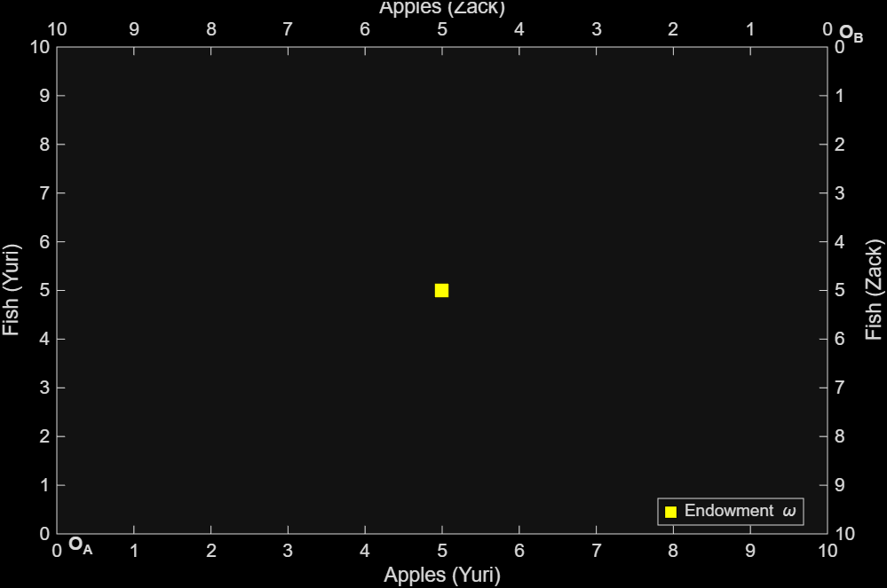{#fig-empty width="100%"}

::: {.callout-note}
Every interior point of the box is a complete allocation of all goods. No resources are wasted.
:::

## 2.3 The Marginal Rate of Substitution

The MRS is the slope of an indifference curve, measuring the rate at which an agent will substitute one good for another:

$$MRS = \frac{MU(x_1)}{MU(x_2)}$$

For the running example:

$$MRS_\text{Yuri} = \frac{x_2 + 3}{x_1}, \quad MRS_\text{Zack} = \frac{x_2 + 2}{x_1}$$

*Why MRS is the key to efficiency: it measures willingness to trade.*

# 3. Pareto Optimality

## 3.1 The Concept

*Definition: an allocation is Pareto optimal if no reallocation makes one agent better off without harming the other.*

*Geometric interpretation: tangency of indifference curves.*

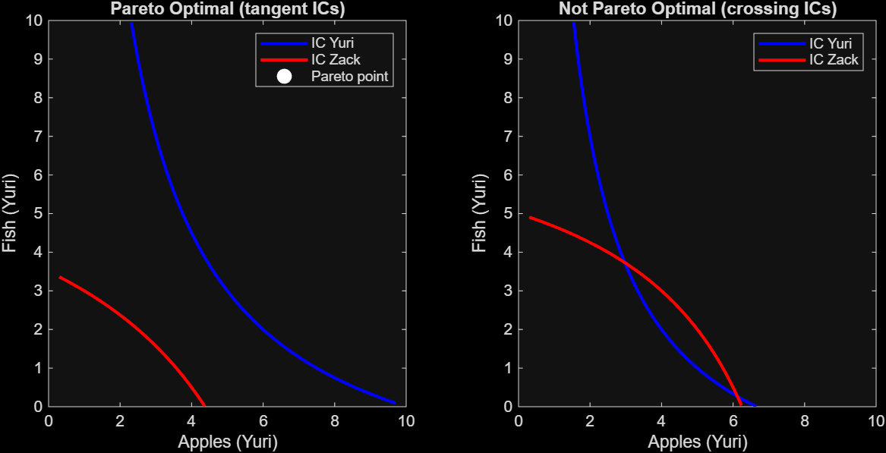{#fig-pareto-concept width="100%"}

## 3.2 The MRS Condition

A Pareto optimal allocation satisfies:

$$\text{MRS}_\text{Yuri}(x_1, x_2) = \text{MRS}_\text{Zack}(\omega_1 - x_1,\ \omega_2 - x_2)$$

*Derivation: why equal MRS means no mutually beneficial trade exists.*

*The substitution: Zack's utility written in Yuri's coordinate frame.*

## 3.3 Special Preference Cases

The solver handles four distinct preference structures, each producing a qualitatively different Pareto set:

::: {layout-ncol=2}

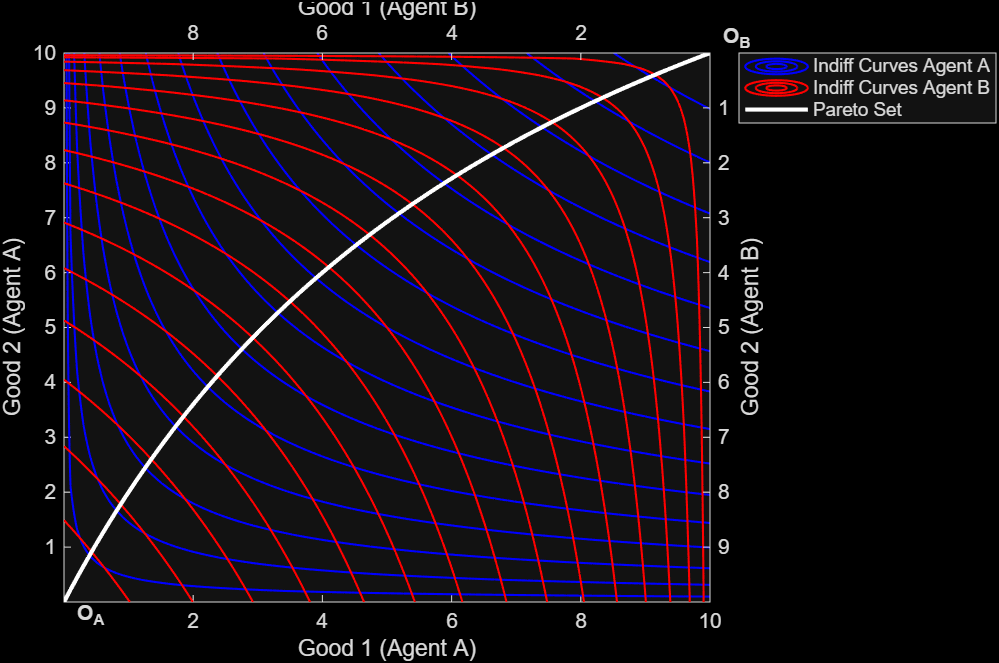{#fig-pref-normal}

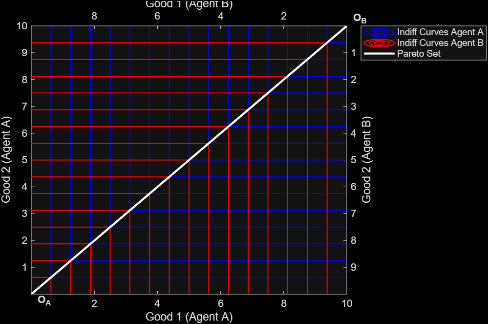{#fig-pref-leontief}

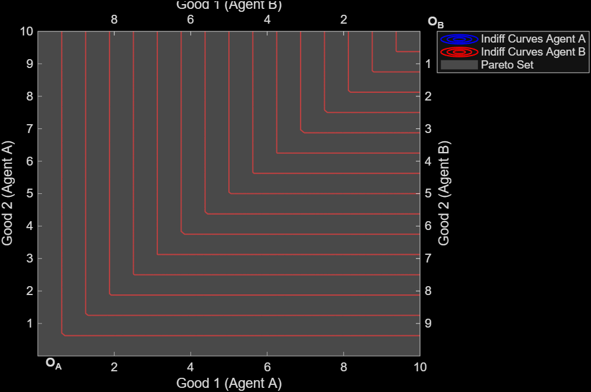{#fig-pref-convex}

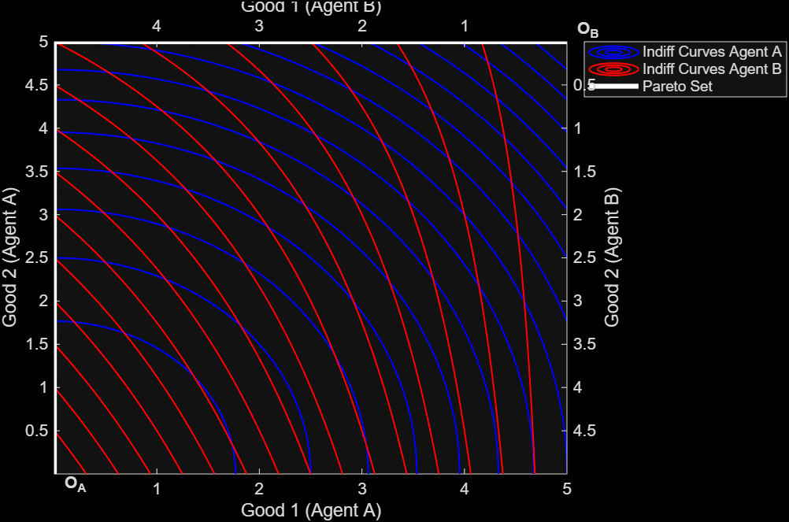{#fig-pref-nonqc}

:::

## 3.4 The Solver Decision Tree

*Prose + flowchart diagram of how `solveParetoSet` dispatches: classify → neutral? → constant MRS? → bordered Hessian test → interior / boundary path.*

*Brief explanation of `paretoBoundary`: why a 100×100 grid dominance check is needed.*

## 3.5 Results

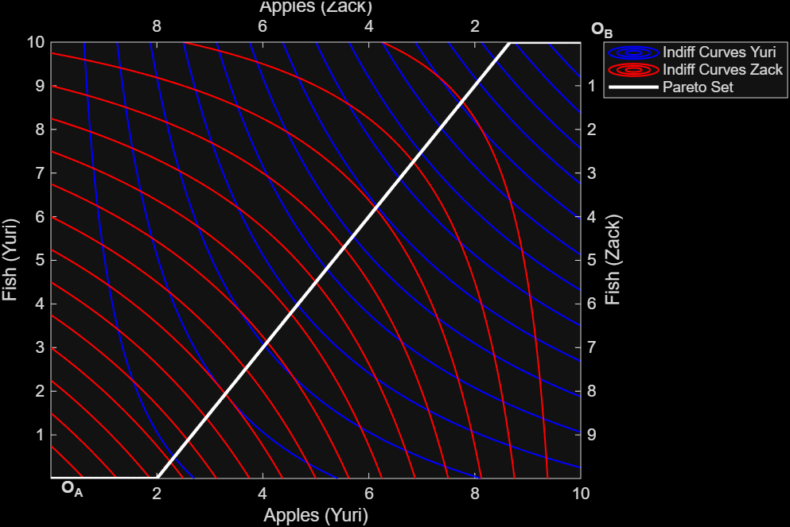{#fig-pareto-running width="100%"}

The contract curve spans the entire box because both agents share the same utility structure. The MRS condition yields allocations along the full diagonal:

| Agent | Good   | Min | Max |
|-------|--------|-----|-----|
| Yuri  | Apples | 0   | 10  |
| Yuri  | Fish   | 0   | 10  |
| Zack  | Apples | 0   | 10  |
| Zack  | Fish   | 0   | 10  |

: Pareto efficiency ranges. {.striped}

::: {.callout-note}
The contract curve is the locus of all deals both agents could agree are efficient, but it says nothing about which one they would actually choose.
:::

# 4. The Core

## 4.1 Individual Rationality

*Why efficiency alone isn't enough: agents have outside options (their own endowment).*

An allocation is individually rational if neither agent prefers their endowment to the proposed deal:

$$u_\text{Yuri}(x_1, x_2) \geq u_\text{Yuri}(5, 5) = 40$$

$$u_\text{Zack}(x_1, x_2) \geq u_\text{Zack}(5, 5) = 35$$

## 4.2 The Core

The core is the intersection of the Pareto set with the individually rational region:

$$\text{Core} = \text{Pareto set} \cap \{x : u_i(x) \geq u_i(\omega_i)\ \forall i\}$$

*Geometric interpretation: the segment of the contract curve between the two IR indifference curves.*

::: {.callout-note}
The core contains every allocation that is simultaneously efficient and voluntarily acceptable. Neither agent would prefer to walk away.
:::

## 4.3 Results

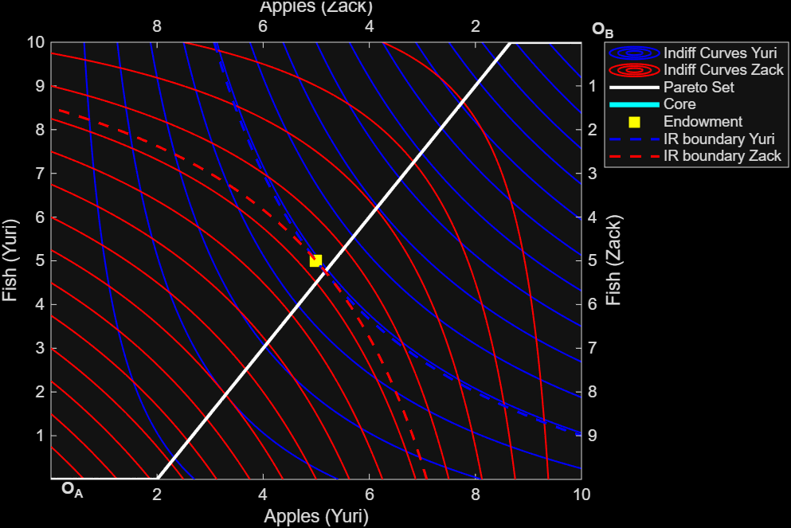{#fig-core width="100%"}

In the running example the core collapses to a single point, a degenerate case where the two IR constraints intersect the contract curve at the same allocation:

| | Apples | Fish |
|---|--------|------|
| Endowment (both agents) | 5.000 | 5.000 |
| IR threshold, Yuri | $u \geq 40$ | |
| IR threshold, Zack | $u \geq 35$ | |
| **Core allocation, Yuri** | **5.165** | **4.747** |
| **Core allocation, Zack** | **4.835** | **5.253** |

: Core of the economy. {.striped}

*Note on degenerate cases: when the core collapses to a point vs. when it spans the entire contract curve.*

# 5. Competitive Equilibrium

## 5.1 The Walrasian Setup

Price normalization: $p_1 = 1$, find $p_2^*$.

Each agent sells their endowment at market prices and buys their preferred bundle subject to:

$$p_1 x_1 + p_2 x_2 = p_1 \omega_{i,1} + p_2 \omega_{i,2}$$

Market clearing requires $d_\text{Yuri}(p_2) + d_\text{Zack}(p_2) = \omega$, which holds by Walras' Law once good 1 clears.

## 5.2 Deriving Demand

The utility maximization problem uses the Lagrangian. The first-order conditions yield:

$$\frac{MU(x_1)}{MU(x_2)} = \frac{p_1}{p_2}$$

combined with the binding budget constraint.

*Engineering point: `makeDemandFn()` derives the formula symbolically once, then returns a vectorized `@(p2)` function handle.*

*Code block (collapsed): the demand derivation for the running example, showing the symbolic formula before vectorization.*

## 5.3 Finding Equilibrium

*How `solveEquilibrium()` works: symbolic `solve()` first, numeric `fzero` fallback.*

The market clears where excess demand $z(p_2) = d_{\text{Yuri},1}(p_2) + d_{\text{Zack},1}(p_2) - \omega_1 = 0$:

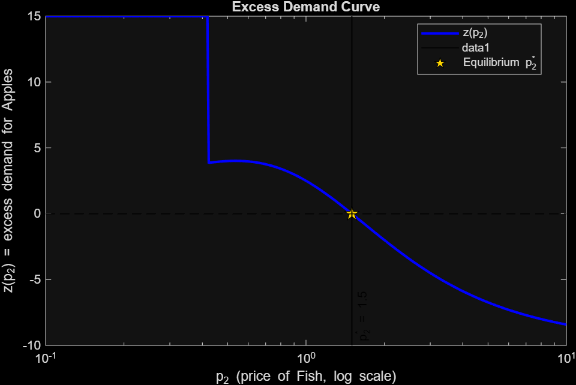{#fig-excess width="100%"}

## 5.4 Offer Curves and the Box

*What an offer curve is: the set of bundles demanded as price varies.*

{#fig-walrasian width="100%"}

## 5.5 Welfare Theorems

**Equilibrium price:** $p_1 = 1,\quad p_2^* = 1.5$

| Agent | Apples | Fish  | $u_\text{CE}$ | $u_\text{endow}$ | Gain    |
|-------|--------|-------|--------------|-----------------|---------|
| Yuri  | 5.231  | 4.846 | 41.04        | 40.00           | +1.04   |
| Zack  | 4.769  | 5.154 | 34.12        | 35.00           | **-0.88** |

: Equilibrium allocations and utility gains from trade. {.striped}

::: {.callout-warning}
**Zack's gain from trade is negative.** The CE is Pareto optimal (FWT holds), but it lies *outside* the core. Zack ends up worse off than at his endowment. This is why the core is a stricter concept than Pareto optimality alone, and why the SWT matters.
:::

**First Welfare Theorem (FWT):** CE is on the Pareto set. The market does not waste resources. ✓

**Second Welfare Theorem (SWT):** a lump-sum tax of $0.21$ on Yuri shifts the budget line to support the core allocation $(5.165,\ 4.747)$ as a CE at the same price $p_2^* = 1.5$. Equity and efficiency can be separated. ✓

*What cases does this fail? Assumptions they rely on: quasiconcavity, continuity, local non-satiation. Are these reasonable?*

# 6. Simulations: How the Market Converges

## 6.1 The Tâtonnement Process

*The auctioneer metaphor: announce price, observe excess demand, adjust, repeat.*

The price update rule uses a multiplicative form to keep prices strictly positive:

$$p_{t+1} = p_t \cdot \exp(\lambda \cdot z(p_t))$$

*Parameters: step size $\lambda$, tolerance, max iterations.*

## 6.2 A Single Trial

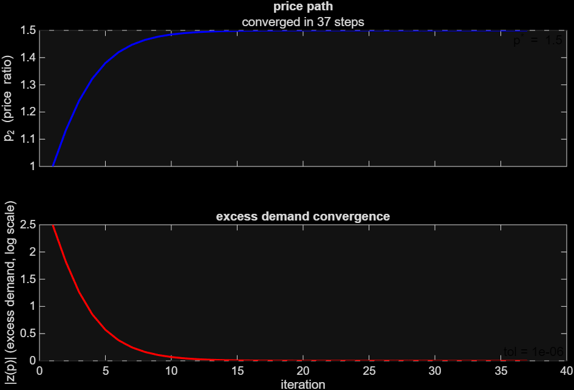{#fig-tatonnement width="100%"}

*What convergence looks like vs. failure to converge.*

## 6.3 Monte Carlo: Many Starting Prices

*Why starting price matters (or doesn't). 80 trials over logspace to test robustness.*

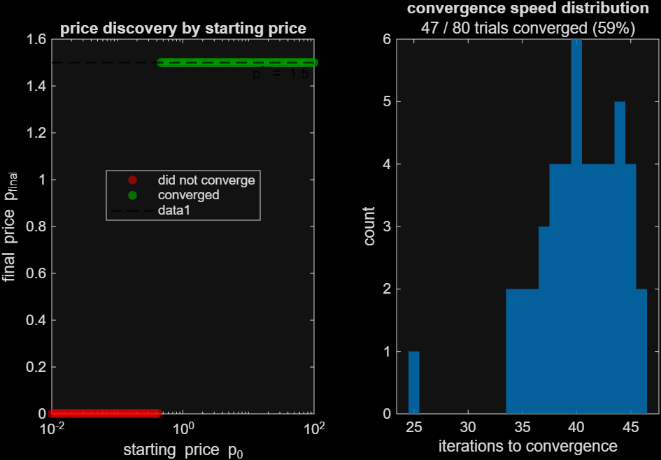{#fig-montecarlo width="100%"}

::: {.callout-note}
If the market converges to the same price regardless of where it starts, the equilibrium is globally stable. The economy finds its way there no matter how chaotic the initial conditions.
:::

# 7. Visualization

## 7.1 The 2x2 Figure

*Layout description: 3D box (top-left), holdings bar chart (top-right), welfare over time (bottom-left), price convergence (bottom-right). How all four panels update simultaneously each frame.*

## 7.2 The Three Cylinder Styles

::: panel-tabset

## Original (Total Goods)

Height = $x_1 + x_2$; color = agent identity.

*What to look for: cylinders drifting toward the CE allocation as trading progresses.*

## Utility Height

Height = normalized utility; cylinders grow taller as agents gain welfare.

*What to look for: both cylinders rising together as each step is a Pareto improvement.*

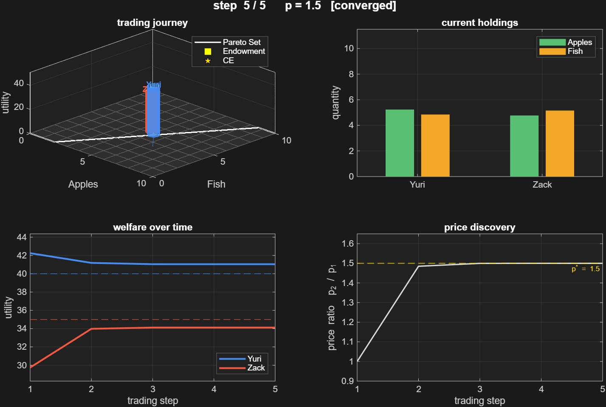{#fig-anim-utility width="100%"}

## Stacked Goods

Green band = Apples held; amber band = Fish held.

*What to look for: as Yuri trades away Apples, his green band shrinks; as he receives Fish, his amber band grows.*

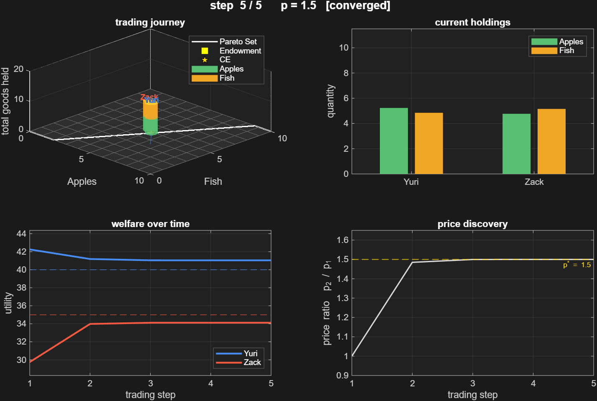{#fig-anim-stacked width="100%"}

:::

## 7.3 Reading the Animation

*Trail lines show the path through allocation space. Pareto set (white) and CE (gold star) anchored on the floor. Agent names float above their cylinders.*

# 8. Technical Architecture

## 8.1 The State Chain

Each section function accepts an optional `'from'` argument carrying all upstream results, so the pipeline reuses computation instead of rerunning it:

```matlab
s = paretoSet(u1, u2, omega);
s = core(u1, u2, w1, w2, 'from', s);
s = walrasian(u1, u2, w1, w2, 'from', s);
s = sims(u1, u2, w1, w2, 'from', s);
s = viz(u1, u2, w1, w2, 'from', s, 'style', 'stacked');
```

Each call extends the struct `s` with new fields:

| Section | Fields added to `s` |
|---------|---------------------|
| `paretoSet` | `px1`, `px2`, `flags`, `mrs`, `X1`, `X2`, `Z_U1`, `Z_U2` |
| `core` | `ir`, `cx1`, `cx2`, `cflags`, `w1`, `w2` |
| `walrasian` | `p_eq`, `x_A`, `x_B`, `oc_A`, `oc_B`, `fwt`, `swt` |
| `sims` | `tatonn`, `mc`, `p_eq_ref` |
| `viz` | `tatonn` (reused), `mc_viz` |

: State struct fields by section. {.striped}

## 8.2 Key Engineering Decisions

*Short paragraph each on:*

*Symbolic then numeric: why derive demand symbolically before evaluating numerically.*

*`matlabFunction` vs `subs` in a loop: 10,000x speedup on grids.*

*`imag(val) ~= 0` check: why `~isfinite` alone misses log/sqrt domain violations.*

*`drawnow limitrate`, non-blocking animation: why not delete/redraw.*

# 9. Limitations and Extensions

## 9.1 Current Limitations

- **Static endowment economy:** no production, no capital accumulation.
- **Two agents, two goods:** the Edgeworth box geometry does not generalize beyond this.
- **Price-taking assumption:** agents have no market power.

## 9.2 Natural Extensions

- **$n$-agent tâtonnement:** aggregate excess demand across $n$ agents with the same update rule.
- **Overlapping generations:** agents trade across time periods.
- **Network trade:** bilateral trades along a graph instead of through a centralized auctioneer.

# 10. Conclusion

*Restate the five questions, answered. What the project demonstrates about general equilibrium theory. Link to GitHub repository.*

---

::: {.callout-note collapse="true"}
## Appendix

**Running the project locally**

Set MATLAB's current folder to `script/`, then open `main.m`. Set `run_through` to control how much executes:

| Value | Runs |
|-------|------|
| 1 | Pareto set + Edgeworth box |
| 2 | + Core |
| 3 | + Competitive equilibrium |
| 4 | + Tâtonnement + Monte Carlo |
| 5 | + Animated trading visualization |

Set `viz_style` to `'utility'` or `'stacked'` to switch animation modes.

---

**Function reference**

| Function | Purpose | Key inputs | Key outputs |
|----------|---------|------------|-------------|
| `paretoSet` | Pareto set + Edgeworth box | `u1`, `u2`, `omega` | `px1/px2`, `flags`, `Z_U1/Z_U2` |
| `core` | Core + IR constraints | `u1`, `u2`, `w1`, `w2` | `cx1/cx2`, `cflags`, `ir` |
| `walrasian` | CE prices, offer curves, FWT/SWT | `u1`, `u2`, `w1`, `w2` | `p_eq`, `x_A/x_B`, `fwt`, `swt` |
| `sims` | Tâtonnement + Monte Carlo | `u1`, `u2`, `w1`, `w2` | `tatonn`, `mc` |
| `viz` | Animated trading journey | `u1`, `u2`, `w1`, `w2` | animation figure |
| `solveParetoSet` | Dispatches to correct Pareto solver | `u1`, `u2`, `mrs`, `omega` | `px1/px2`, `flags` |
| `solveEquilibrium` | Symbolic then numeric CE solve | `u1`, `u2`, `w1`, `w2` | `p_eq`, `x_A`, `x_B` |
| `makeDemandFn` | Vectorized demand function factory | `u`, `w`, `omega` | `@(p2)` function handle |
| `runTatonnement` | Single tâtonnement trace | `dFn_A`, `dFn_B`, `omega` | `p_path`, `xA_path`, `z_path` |
| `runMonteCarlo` | Sweep over starting prices | `dFn_A`, `dFn_B`, `omega` | `p_final_arr`, `conv_rate` |

: Function reference. {.striped}

---

**Test cases**

| # | $u_1$ | $u_2$ | Pareto set type |
|---|-------|-------|-----------------|
| 1 | $\log(x_1-3) + x_2^2$ | $\max(x_1, x_2+3)$ | Boundary (asymptote) |
| 2 | $x_1^2 + x_2^2$ | $x_1(x_2+3)$ | Boundary (non-QC) |
| 3 | $x_1$ | $x_2$ | Single point |
| 4 | $x_1+x_2$ | $x_1+x_2$ | Full box |
| 5 | $x_1+4+x_2$ | $x_1+2x_2$ | Boundary (linear, unequal) |
| 6 | $\min(x_1,x_2)$ | $\min(x_1,x_2)$ | Region (equal Leontief) |
| 7 | $\min(2x_1, x_2-4)$ | $\min(x_1, x_2+3)$ | Region (unequal Leontief) |
| 8 | $\min(x_1,x_2)$ | $\max(x_1,x_2)$ | Boundary (Leontief vs max) |
| 9 | $\min(2x_1, x_2+100)$ | $\min(-20x_1, x_2+3)$ | Out of bounds |
| 10 | $x_1 - 2x_2$ | $x_1$ | Neutral/bad good |
| 11 | $x_1(x_2+3)$ | $x_1(x_2+2)$ | Interior curve (running example) |
| 12 | $x_1 + 2\log x_2$ | $x_1 + 2\log x_2$ | Interior curve (quasilinear) |
| 13 | $-(x_1-5)^2-(x_2-5)^2$ | $x_1 x_2$ | Satiation point |

: All 13 test cases. {.striped}
:::
